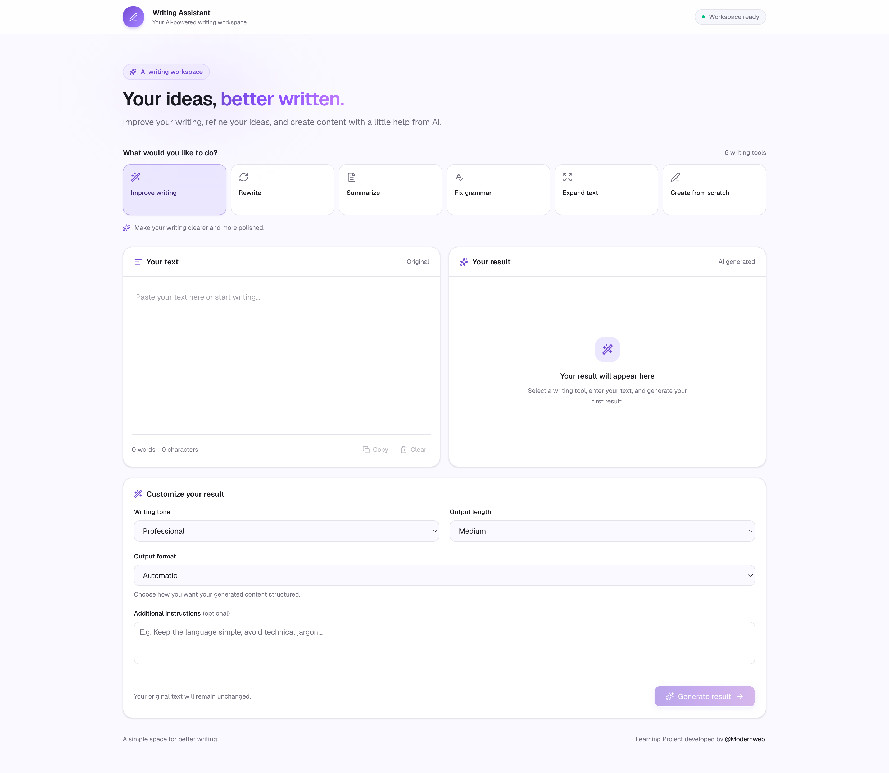
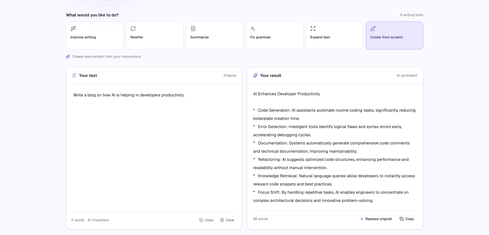

# Modern Web — AI Writing Assistant

Supporting resources and reference code for the **Modern Web AI Writing Assistant tutorial**.

This repository contains the UI components, styling, API testing examples, and documentation used throughout the tutorial.

> **Important:** This is not a complete Next.js application and is not intended to be cloned and run directly. You'll create your own project during the tutorial and use the resources here when needed.

## What We're Building

An AI-powered writing assistant that helps users improve, rewrite, summarize, correct, expand, and generate written content.

### Features

The completed application will support:

- Six writing operations: Improve, Rewrite, Summarize, Grammar, Expand, and Generate.
- Configurable writing tones and output lengths.
- Multiple output formats.
- Custom writing instructions.
- AI-powered text generation.
- Multiple AI providers with automatic fallback.
- Request validation and API protection.

## Preview



*Main application interface.*



*Example of a generated writing result.*

## Technologies

- Next.js
- React
- TypeScript
- Tailwind CSS
- shadcn/ui
- Vercel AI SDK
- Zod
- Upstash Redis

## Repository Structure

```text
.
├── api-tests/
│   ├── generate.http
│   ├── payloads/
│   │   └── oversized.json
│   └── postman/
│       └── writing-assistant.postman_collection.json
│
├── docs/
│   ├── POSTMAN_GUIDE.md
│   ├── PROJECT_ARCHITECTURE.md
│   └── REST_CLIENT_GUIDE.md
│
├── ui/
│   ├── app/
│   │   └── globals.css
│   └── components/
│       └── writing-assistant/
│           ├── constants.ts
│           ├── editor-panel.tsx
│           ├── generation-settings.tsx
│           ├── header.tsx
│           ├── introduction.tsx
│           ├── operation-selector.tsx
│           ├── output-panel.tsx
│           └── types.ts
│
├── LICENSE
└── README.md
```

## Using This Repository

Follow the tutorial to create your own Next.js application.

The repository provides the following resources:

| Resource | Description |
|---|---|
| `ui/components/writing-assistant/` | Reference UI components and supporting types/constants |
| `ui/app/globals.css` | Global styles, theme variables, and animations |
| `api-tests/` | Ready-to-use API testing examples |
| `docs/` | Architecture overview and API testing guides |

### UI Components and Styling

The UI components are provided as visual references. They contain the presentation structure but do not include the complete application behavior.

During the frontend section of the tutorial, we'll progressively implement the component props, state, event handlers, and application logic.

You can copy the relevant component files into your own project and use the provided `globals.css` for styling.

Before using the components, make sure you've created a Next.js project, initialized shadcn/ui, and installed the required dependencies.

### API Testing

The repository includes resources for testing the backend independently:

- `api-tests/generate.http` — HTTP requests for the VS Code REST Client extension.
- `api-tests/postman/` — Postman collection covering generation, validation, and request protection.
- `api-tests/payloads/` — Supporting payloads for request-size testing.

Refer to the documentation for instructions:

- [REST Client Guide](docs/REST_CLIENT_GUIDE.md)
- [Postman Guide](docs/POSTMAN_GUIDE.md)

## Architecture

For a high-level overview of the application and how its main components interact, see:

[Project Architecture](docs/PROJECT_ARCHITECTURE.md)

Detailed implementation and API behavior will be covered throughout the tutorial.

## Tutorial

**Video:** Coming soon.

Follow along to understand how the frontend, request validation, prompt engineering, AI integration, provider fallback, and API protection work together.

## About Modern Web

Modern Web creates practical developer tutorials and projects focused on modern web technologies.

- Website: https://modernweb.in
- YouTube: https://www.youtube.com/@modernweb

## License

This repository is licensed under the [MIT License](LICENSE).